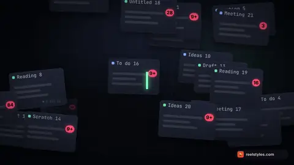
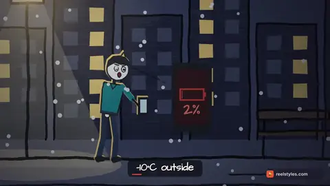
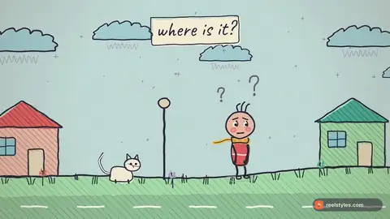
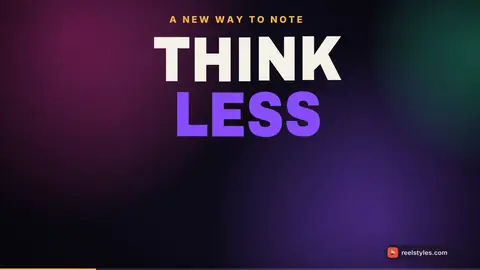
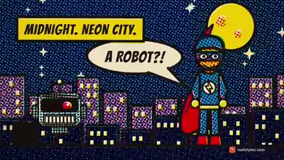

# ReelStyles Free 2026.11.12

7 video styles for Claude Code and other coding agents. You pick a style, give your agent a topic, and it animates the film in code and renders an MP4 on your computer.

Each clip below was made with its kit. All 7 kits are complete and MIT licensed, so you can use them in paid work too.

[](https://reelstyles.com/style/dark-keynote)
[](https://reelstyles.com/style/whiteboard)
[](https://reelstyles.com/style/doodle-film)
[](https://reelstyles.com/style/kinetic-type)
[](https://reelstyles.com/style/stick-metaphor)
[](https://reelstyles.com/style/guess-quiz)
[](https://reelstyles.com/style/comic-panels)

To try it in Claude Code, run the two /plugin lines below and ask for "a 20 s video about coffee in the whiteboard style". The first video takes about 20 minutes, setup included. After that a short video renders in a few minutes.

Each kit is a set of plain files: a style guide, scene templates, render steps and a rubric the agent checks its own frames against. Any agent that can read files and use a terminal can work with them, for example Claude Code, Codex, Cursor, Roo Code, Cline, Gemini CLI or GitHub Copilot. The agent writes each scene in code and HyperFrames renders it on your computer. You don't need an AI video model for this.

**Start here:** tell your agent **"set up ReelStyles"**. It runs the `reelstyles-setup` skill, which checks for Node.js 22+, ffmpeg and Chrome and asks before it installs anything missing. Then it connects ReelStyles to your agent and renders a 5 s test film. You can also run the script yourself: `bash setup/setup.sh install`, then `wire auto`, then `test` (on Windows PowerShell: `powershell -ExecutionPolicy Bypass -File setup\setup.ps1 install`, then the same commands).

After that, ask for a film: **"Read skills/reelstyles/SKILL.md, then make me a 30 s video about TOPIC in the STYLE style."** Replace TOPIC with your subject and STYLE with a style from `skills/reelstyles/STYLES.md`.

## Install in Claude Code
```
/plugin marketplace add reelstyles/reelstyles-free
/plugin install reelstyles-free@reelstyles-free
```
To update later, run `/plugin marketplace update reelstyles-free`.

## Use it with Codex, Cursor, Roo Code, Cline, Gemini CLI, Copilot or another agent
Clone this repo (or unzip it) into your project or next to it. Agents that read `AGENTS.md` will find the skill from there. You can also copy `skills/reelstyles/` into the folder where your agent looks for skills or rules. To update, run `git pull`.

## What you need
Node.js 22 or newer, ffmpeg, and Chrome or Chromium (HyperFrames uses it to render). The setup skill can install them for you if you say yes. Long films render faster on a computer with more CPU cores.

## Licence
MIT. You can use, change and share these kits, also for commercial work. The full text is in LICENSE.md.

## More styles
Full has all 126 and every style added later. It costs $49 for the first 20 buyers and $79 after that. You pay once. Current prices are at https://reelstyles.com/pricing?utm_source=free-kit
